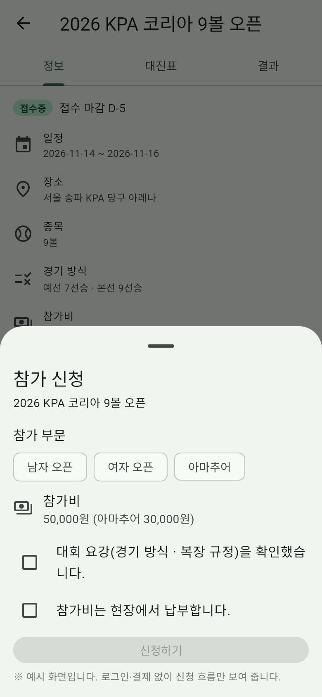
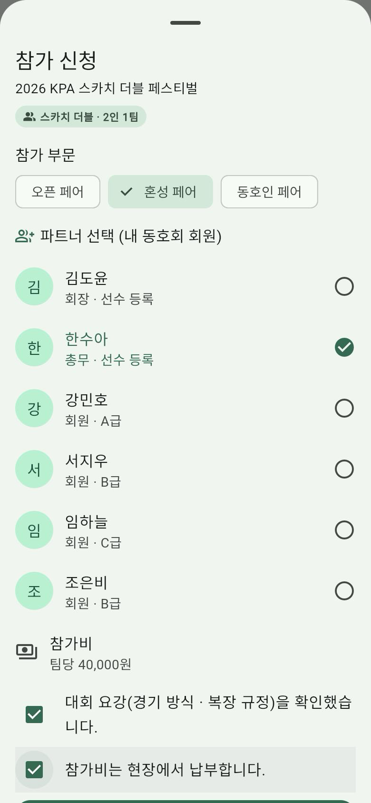
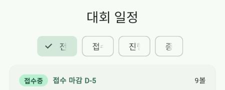
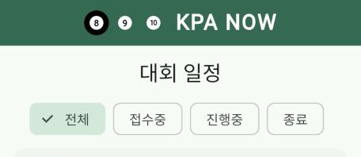
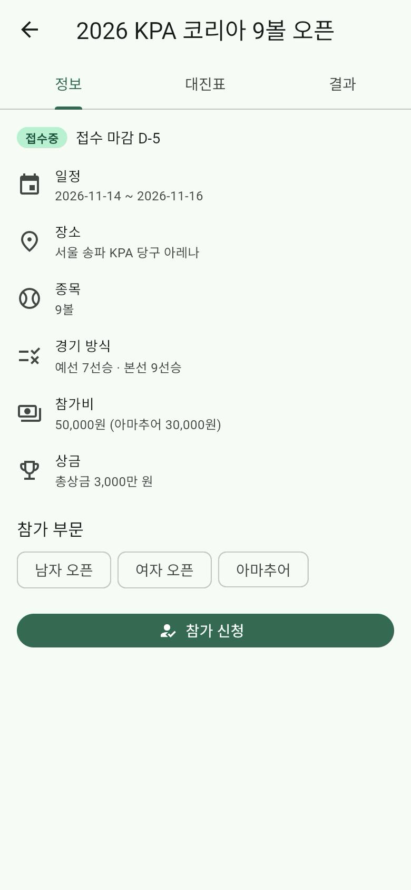
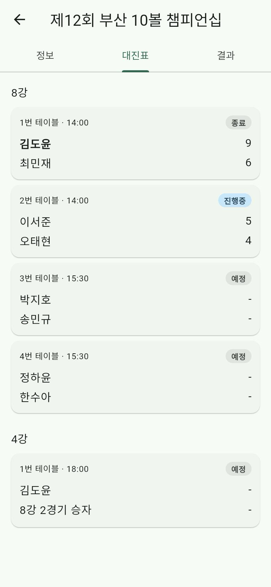

# 셀프 논증 기록 (제출물 ① 저장소 `docs/` · 20점)

> 1인 과제이므로 "협업" 대신 **스스로 논증**합니다. 내 설계 결정마다 **AI를 반론자로 세워** 약점을 공격받고, 다시 반박하거나 고쳐서 결론을 냅니다.
> 구조(쟁점마다): **내 주장 → 반론(AI · 나) → 재반론 · 수정 → 결론(유지 · 수정 · 폐기) → 근거(원칙 P번호 · 리뷰) → 전 · 후 화면**
> 이론: Toulmin 논증 모형(1958, *The Uses of Argument*) — 주장 · 근거 · 보증 · **반론**. 반론을 견딘 주장이 근거 있는 결정입니다.
> 증거: `docs/prompt-log.md`에서 AI에게 반론을 요청한 줄(날짜) · `docs/원칙카드.md`의 P번호. "AI가 그렇게 해서"는 근거가 아닙니다.
> 전·후 기준점: 각 쟁점의 "전"은 고치기 전(또는 다른 선택지의) 화면 캡처, "후"는 지금 화면 캡처입니다.

작성자: 권오빈 · 사용한 AI 도구: Claude (Claude Code)

> **TODO(작성자)**: "(나)" 반론과 재반론은 내 판단을 적는 칸입니다. 쟁점 1 · 3의 문장은 초안이니 내 말로 고쳐 씁니다. 쟁점 2의 (나) 반론은 직접 앱을 실행해 발견한 문제입니다. 리뷰 번호(R1–R17)는 `docs/리뷰분석.md`.

## AI에게 반론을 요청하는 법 (예)
- "이 화면(E 참가 신청) 설계의 약점을 닐슨 원칙 번호로 3개 반박해 줘. 칭찬은 빼고."
- "내가 고른 '상태에 맞는 탭을 먼저 연다'에 반대하는 입장에서 논증해 줘."
- 요청과 AI 답은 `docs/prompt-log.md`에 한 줄로 남기고, 아래 표의 증거 칸에 그 줄을 적습니다.

## 쟁점 목록

쟁점은 3개, 하나에 한 행입니다.

| # | 쟁점 (화면 · 요소 번호) | 내 주장 | 반론 (AI · 나) | 재반론 · 수정 | 결론 | 근거 (원칙 P번호 · 리뷰) | 전 · 후 화면 | 증거 (prompt-log · 원칙 카드) |
|---|---|---|---|---|---|---|---|---|
| 1 | 스카치 더블 파트너를 어떻게 정할까 (E-7) | 파트너 이름을 입력하지 않고, 참가 신청 시트에서 **내 동호회 회원 목록**을 보여 주고 고르게 한다 | (AI) 동호회 밖 사람과 나가고 싶은 선수는 신청할 수 없고, 회원이 많으면 목록에서 찾기 어렵다 — P07 · (나) 동호회 회원이 한 명도 없으면 신청 자체를 못 한다 | 이 대회는 "동호회 단체상"이 있는 동호회 중심 대회이고, 동호회 회원은 7명 수준이라 목록이 짧다. 회원이 없으면 빈 화면이 아니라 "함께 신청할 동호회 회원이 없습니다." 안내(EmptyView)를 보여 준다. 다른 동호회 파트너 검색은 v3로 남긴다 | **유지** | P06(입력 대신 고르기) · P05(파트너를 고르기 전에는 신청 불가) · 리뷰 R4 "동호회 검색은 어디서 합니까 왜 검색하는게 안보이죠" — ★2 · 2023-03-29 | 전 `screenshots/i1_before.png` → 후 `screenshots/i1_after.png` | prompt-log 6행 · 원칙 카드 P06 |
| 2 | 대회 상태 필터 칩이 잘려 보이는 문제 (T-2 · R-2) | 상태 필터는 Material 기본 `ChoiceChip` 4개(전체 · 접수중 · 진행중 · 종료)로 충분하다 | (나) 웹(Chrome)으로 실행하니 칩 글자가 잘려 "접수중"이 "접"만 보인다 — 필터 이름을 읽을 수 없어 P06 위반, 랭킹의 "남자" 버튼도 두 줄로 깨진다 — P04 · (AI) 원인은 한글 글꼴이 늦게 도착하기 전의 너비로 칩을 잰 것. 해결안 두 가지: ① Noto Sans KR 글꼴 파일을 앱에 넣기 ② 글꼴이 도착하면 칩을 다시 재기 | 내 반론이 맞다 → 고친다. ①은 글꼴 파일 다운로드가 필요하고 웹 첫 로딩이 수 MB 무거워진다. ②`RebuildOnFontLoad`를 T-2 · R-2에 적용해 글꼴 도착 후 다시 잰다. 폰 · 데스크톱 앱에는 영향 없음 | **수정** | P06(필터 이름이 보여야 고를 수 있음) · P04(같은 버튼이 화면마다 다르게 깨지지 않게) · 리뷰 근거 없음 — 직접 실행해 발견 | 전 `screenshots/i2_before.png` → 후 `screenshots/i2_after.png` | prompt-log 5행 · 원칙 카드 P06 |
| 3 | 대회 상세를 열면 어느 탭을 먼저 보여 줄까 (D-2) | 대회 상태에 맞는 탭을 먼저 연다 — 접수중 → 정보, 진행중 → 대진표, 종료 → 결과 | (AI) 같은 화면인데 열 때마다 첫 탭이 달라 일관성이 깨지고, 정보 탭을 찾던 사용자가 헤맬 수 있다 — P04 · (나) 접수중 대회를 대진표 탭부터 열면 빈 화면을 먼저 보게 된다 | (나)의 반론은 지금 설계가 이미 피한다(접수중은 정보 탭). AI 반론은 받지 않는다: 탭 이름 3개가 항상 보이고 선택된 탭에 밑줄이 있어 지금 위치를 알 수 있고(P06), 다른 탭도 한 번에 간다. 상태마다 가장 먼저 찾는 정보가 다르다 | **유지** | P07(가장 자주 찾는 정보로 바로) · P06(탭 이름이 항상 보임) · 리뷰 R11 "대회결과 및 영상을 볼 수있어서 좋아요~" — ★5 · 2019-08-20 · R12 "경기결과를 실시간으로 알수 있어서 좋네요" — ★5 · 2019-08-20 | 전 `screenshots/i3_before.png` → 후 `screenshots/i3_after.png` | prompt-log 7행 · 원칙 카드 P07 |

- **결론**: 유지(반론을 반박하고 그대로 감 — 반박 근거 필요) · 수정(반론을 받아 고침) · 폐기(주장을 버림 — 왜).
- 반론 없이 내 주장만 있으면 논증이 아닙니다. AI 반론을 그대로 받기만 하고 재반론이 없어도 약합니다.
- 옆 사람 · 강사 클리닉에서 받은 의견도 반론으로 적을 수 있습니다.

## 전 · 후 화면 (쟁점별)

### 쟁점 1 — 스카치 더블은 동호회 회원 중에서 파트너 고르기 (E-7)

| 전 (개인전 참가 신청 — 파트너 칸 없음) | 후 (스카치 더블 참가 신청 — 파트너 선택) |
|---|---|
|  |  |

- 관련 커밋: `git log --oneline --grep="스카치 더블"` · 원칙 카드: P06 · prompt-log: 2행 · 6행

### 쟁점 2 — 웹에서 잘리던 상태 필터 칩을 글꼴 도착 후 다시 재기 (T-2 · R-2)

| 전 (글자 잘림) | 후 (전체 · 접수중 · 진행중 · 종료) |
|---|---|
|  |  |

- 관련 커밋: `git log --oneline --grep="칩 글자 잘림"` · 원칙 카드: P06 · prompt-log: 5행

### 쟁점 3 — 대회 상태에 맞는 탭을 먼저 열기 유지 (D-2)

| 전 (접수중 대회 → 정보 탭) | 후 (진행중 대회 → 대진표 탭) |
|---|---|
|  |  |

- 관련 커밋: `git log --oneline --grep="KPA NOW v2 UI"` · 원칙 카드: P07 · prompt-log: 7행
